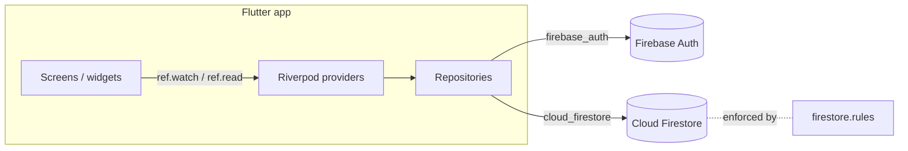
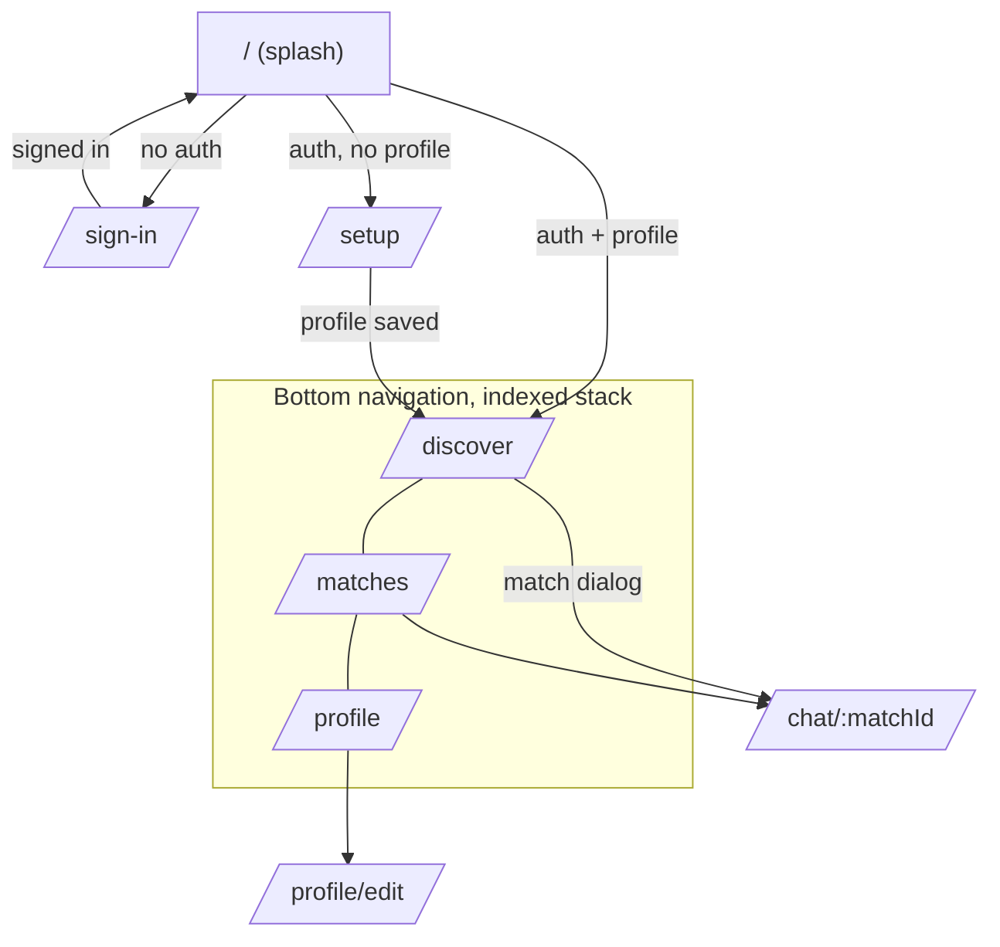
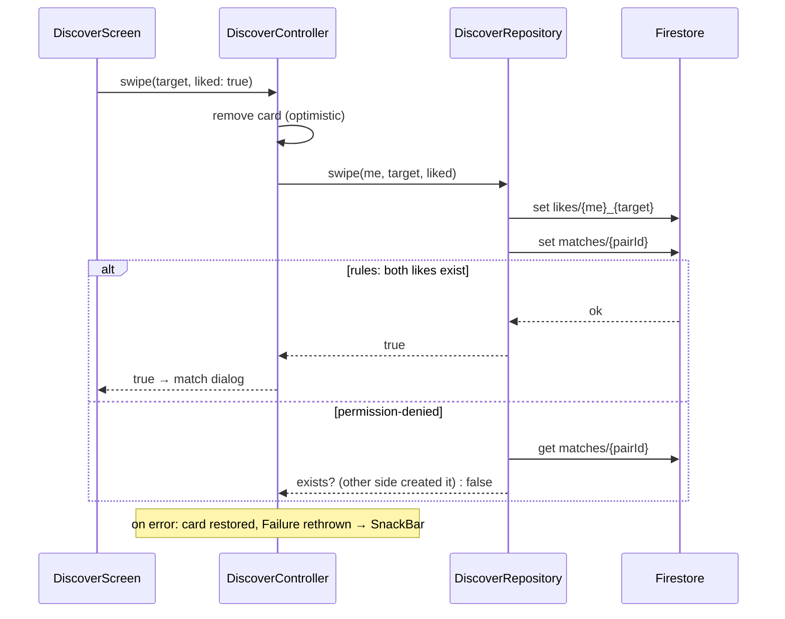

# Architecture

## Overview

Skill Swap is a single Flutter app talking directly to Firebase (Auth + Cloud Firestore). There is no custom server: business rules that must be trusted (who may write what, when a match may exist) live in [`firestore.rules`](../firestore.rules); the rest runs in the app.

## Why this shape

- **Feature-first, no separate domain layer.** Each feature has one file with its model + repository + providers and one file per screen. The app is small (4 features, ~8 screens); use cases and repository interfaces would only add indirection. See [ADR 0002](adr/0002-feature-first-riverpod.md).
- **Firebase.** Gives auth, a real-time database for chat, and server-side authorization without operating a backend. See [ADR 0001](adr/0001-firebase-backend.md).
- **Client-side match creation guarded by rules.** See [ADR 0003](adr/0003-client-side-matching-with-rules.md).

## Layers and modules

| Location | Responsibility |
|---|---|
| `lib/main.dart` | `Firebase.initializeApp`, root `ProviderScope`. |
| `lib/app.dart` | `MaterialApp.router`: themes, `themeMode: ThemeMode.dark`, localization, router. |
| `lib/core/error/failure.dart` | `sealed class Failure`, `mapToFailure`, `guard()` for futures, `mapFailures()` for streams. |
| `lib/core/firebase_providers.dart` | `firebaseAuthProvider`, `firestoreProvider` (overridable), collection names. |
| `lib/core/l10n/l10n.dart` | `context.l10n`, `appLocalizationsDelegates`, `failureMessage()`, locale fallback. |
| `lib/core/router/` | Route paths, `resolveRedirect`, `routerProvider`, bottom-navigation shell, splash. |
| `lib/core/theme/` | Design tokens and `AppTheme.dark()` / `AppTheme.light()`. |
| `lib/core/widgets/app_widgets.dart` | Shared components ([COMPONENTS.md](COMPONENTS.md)). |
| `lib/features/auth/` | `AuthRepository`, `authStateProvider`, `SignInScreen`. |
| `lib/features/profile/` | `UserProfile`, `Compatibility`, `ProfileRepository`, `currentProfileProvider`, `Skills` catalog, profile screens. |
| `lib/features/discover/` | `DiscoverRepository`, `DiscoverController`, `SwipeCard`, `DiscoverScreen`. |
| `lib/features/matches/` | `Match`, `ChatMessage`, `MatchRepository`, `matchesProvider`, `messagesProvider`, matches/chat screens. |

Dependency direction: `features/* → core/*`. `discover` imports `matches` (for `Match.pairId`) and `profile`. `core/router` imports feature screens (composition root).

## State management (Riverpod 3)

| Provider | Type | Purpose |
|---|---|---|
| `authStateProvider` | `StreamProvider<String?>` | Signed-in uid. |
| `currentProfileProvider` | `StreamProvider<UserProfile?>` | Live profile of the signed-in user; `null` until created. |
| `discoverControllerProvider` | `AsyncNotifierProvider.autoDispose` | Candidate deck; optimistic removal on swipe, restores on failure. |
| `matchesProvider` | `StreamProvider.autoDispose` | Live list of the user's matches. |
| `userProfileProvider(uid)` | `StreamProvider.autoDispose.family` | Another member's public profile (name in Matches/Chat). |
| `messagesProvider(matchId)` | `StreamProvider.autoDispose.family` | Live latest 100 messages. |
| `*RepositoryProvider` | `Provider` | Dependency injection of repositories. |

Ephemeral UI state (form fields, loading flags, drag offset) stays in `StatefulWidget`s.

Dependency injection is Riverpod itself: tests override `firestoreProvider`, `firebaseAuthProvider`, `authStateProvider` or `currentProfileProvider`.

## Navigation (go_router)

`resolveRedirect()` is a pure function (unit-tested). `routerProvider` re-evaluates it whenever `authStateProvider` or `currentProfileProvider` changes, via a `ValueNotifier` used as `refreshListenable`. Signing out therefore returns the user to sign-in automatically.

## Data flow example: swipe "Interested"

## Startup

1. Native launch screen: solid black (Android `LaunchTheme`, Android 12+ system splash with a transparent icon, iOS storyboard).
2. `main()` → `Firebase.initializeApp` → `runApp`.
3. `MaterialApp.router(builder:)` wraps the router with `SkillSwapSplashScreen`, fed by `startupResolvedProvider` (`lib/core/startup/startup_state.dart`).
4. The router redirect works exactly as before underneath (splash route `/` until state is known, then sign-in / setup / consent / discover). The animated splash only covers it and reveals it once resolved.

## Error handling

1. Repositories wrap Firebase calls in `guard()` (futures) or `.mapFailures()` (streams).
2. `mapToFailure` converts `FirebaseAuthException` / `FirebaseException` codes to `Failure` subclasses (`NetworkFailure`, `InvalidCredentialsFailure`, `EmailInUseFailure`, `WeakPasswordFailure`, `PermissionFailure`, `UnknownFailure`).
3. UI shows `l10n.failureMessage(error)`: in a SnackBar for actions, or in `ErrorView` (with retry → `ref.invalidate`) for screen loads.

## Persistence and caching

- No custom local database. Cloud Firestore's built-in offline persistence (enabled by default on Android/iOS) caches read documents and queues writes.
- Firebase Auth persists the session on the device.
- No in-memory cache beyond Riverpod provider state; `autoDispose` providers release listeners when screens close.

## External services

Only Firebase. See [API.md](API.md).

## Lifecycle

- Controllers (`TextEditingController`, `AnimationController`) are disposed in `dispose()`.
- `mounted` / `context.mounted` checked after every `await` in widgets; `ref.mounted` in `DiscoverController`.
- Firestore listeners are tied to providers and cancelled on dispose.

## Scalability notes

Current limits and the next step for each:

| Limit | Next step |
|---|---|
| Discover reads up to 50 users with `array-contains-any` (≤30 values) and ranks on the client. | Precompute candidates in a Cloud Function or use paginated queries. |
| Match creation on the client. | Firestore-triggered Cloud Function on `likes` writes. |
| Chat loads latest 100 messages. | Cursor pagination with `startAfterDocument`. |
| `matches` sorted on the client. | Composite index on `userIds` + `lastMessageAt`. |
