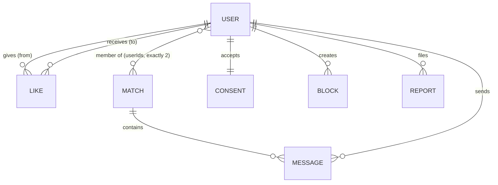

# Data Models

## Entities

### `users/{uid}` ↔ `UserProfile` (`lib/features/profile/profile.dart`)

| Field | Type | Required | Rules |
|---|---|---|---|
| (doc id) `id` | string | yes | Firebase Auth uid |
| `name` | string | yes | 1–40 chars |
| `bio` | string | yes (may be empty) | ≤ 160 chars |
| `teach` | list<string> | yes | catalog skill ids only, ≤ 20 |
| `learn` | list<string> | yes | catalog skill ids only, ≤ 20 |
| `updatedAt` | timestamp | yes | must be the server time of the write |
| `photo` | bytes (Blob) | no | JPEG (starts with `FF D8 FF`), 4 B – 48 KiB; the app uploads a 384 px square without metadata (ADR 0004) |

Deserialization (`UserProfile.fromMap`) is tolerant: missing strings → `''`, non-list → `[]`, non-string or non-catalog skill ids dropped. `photo` is kept only when `ProfilePhoto.isAcceptable` (JPEG ≤ 48 KiB, frame ≤ 1024 px read from the header); otherwise the initials are shown. Saving a profile without a photo deletes the field. Serialization: `toMap()` + `updatedAt`.

Skill ids (stable, never rename; the list is duplicated in `firestore.rules` → `skillIds()` and must stay in sync): `excel, english, spanish, programming, python, guitar, piano, math, physics, chemistry, photoEditing, videoEditing, cooking, crafts, drawing, writing, publicSpeaking, photography, design, marketing`.

### `likes/{fromUid}_{toUid}` (no Dart class; written by `DiscoverRepository`)

| Field | Type | Required |
|---|---|---|
| `from` | string (uid) | yes, must equal author |
| `to` | string (uid) | yes, an existing user, not the author |
| `liked` | bool | yes (`false` = skip) |
| `createdAt` | timestamp | yes, server time |

One document per ordered pair; a later swipe would overwrite it (the UI never shows the same person twice). Readable **only by the author**.

### `matches/{uidA}_{uidB}` ↔ `Match` (`lib/features/matches/matches.dart`)

Id = both uids sorted lexicographically and joined with `_` (`Match.pairId`).

| Field | Type | Required | Notes |
|---|---|---|---|
| `userIds` | list<string> | yes | exactly 2, sorted (`[0] < [1]`) |
| `status` | string | yes on new matches | `active` or `closed`; missing (legacy) = active |
| `closedBy` / `closedAt` | string / timestamp | when closed | member who closed it; server time |
| `lastMessage` | string? | yes (null at creation) | preview; must equal the text of `lastMessageId` |
| `lastMessageId` | string? | yes (null at creation) | id of the message the preview mirrors, created in the same batch |
| `lastMessageAt` | timestamp | yes | sort key; server time |
| `createdAt` | timestamp | yes | server time |

Names are **not** stored: the app reads them from `users/{otherUid}` (`userProfileProvider`). Matches created before 2026-11-20 may still carry a legacy `names` field; it is ignored.

### `matches/{id}/messages/{autoId}` ↔ `ChatMessage`

| Field | Type | Required | Rules |
|---|---|---|---|
| `senderId` | string | yes | must equal author |
| `text` | string | yes | 1–2000 chars, trimmed |
| `createdAt` | timestamp | yes | must be server time; pending local writes read as `DateTime.now()` |

### `users/{uid}/private/consent` (owner only)

| Field | Type | Rules |
|---|---|---|
| `termsVersion` | int | must equal `ProfileRepository.termsVersion` (1) and `termsVersion()` in the rules |
| `adult` | bool | must be `true` (18+, self-declared) |
| `acceptedAt` | timestamp | server time |

### `blocks/{blocker}_{blocked}` (blocker only)

| Field | Type | Rules |
|---|---|---|
| `blocker` | string | the caller |
| `blocked` | string | existing user, not the caller |
| `createdAt` | timestamp | server time |

### `reports/{autoId}` (write-only for users)

| Field | Type | Rules |
|---|---|---|
| `reporterId` | string | the caller |
| `reportedId` | string | existing user, not the caller |
| `reason` | string | `harassment`, `spam`, `inappropriate`, `fake`, `other` (`ReportReason`) |
| `details` | string | ≤ 500 chars (may be empty) |
| `matchId` | string? | null (from Discover) or a match containing both people |
| `createdAt` | timestamp | server time |

## Community (ADR 0005)

| Path | Fields | Who writes | Who reads |
|---|---|---|---|
| `posts/{postId}` ↔ `CommunityPost` | authorId, description (≤ 2000), type (`project`/`tip`/`knowledge`/`question`/`achievement`/`work`), skillIds (≤ 5, catalog), tags (≤ 10), keywords (≤ 40, normalized), visibility (`public`), mediaCount (0–5), aspectRatios, thumb? (JPEG ≤ 24 KiB), createdAt, updatedAt (server time) | author, with the `rateLimits` stamp in the same batch; edits only text/type/skills/tags/keywords | members |
| `posts/{postId}/media/{0..4}` | data (JPEG ≤ 300 KiB), width, height (≤ 1440) | author, only in the post's creation batch | members |
| `posts/{postId}/video/{0..2}` ↔ `PostVideoInfo` (post field `video`: chunks 1–3, bytes ≤ 2.34 MiB, durationMs ≤ 60000, width/height ≤ 4096) | data (≤ 800 KiB slice of the MP4) | author, all chunks in the post's creation batch | members |
| `posts/{postId}/likes/{uid}` | createdAt | the member (doc id = uid → one like) | members |
| `posts/{postId}/comments/{id}` ↔ `CommunityComment` | authorId, text (≤ 1000), parentId (null or a top-level comment), createdAt | author, with the `rateLimits` stamp; deleted by its author, the post author or the thread author | members |
| `follows/{follower}_{following}` | followerId, followingId, createdAt | follower; deleted by either side | members |
| `users/{uid}/saved/{postId}` | createdAt | owner | owner |
| `users/{uid}/notifications/{id}` ↔ `CommunityNotification` | type (`like`/`comment`/`reply`/`follow`/`learn`), actorId, postId?, commentId?, read, createdAt; ids `like_{post}_{actor}`, `comment_{id}`, `reply_{id}`, `follow_{actor}`, `learn_{actor}` | the actor, only for a real event | recipient (marks read / deletes) |
| `rateLimits/{uid}` | lastPostAt (30 s cooldown), lastCommentAt (3 s) | owner, only forward after the cooldown | owner |
| `reports/{id}` (content shape) | reporterId, reportedId (= author), reason, details, targetType (`post`/`comment`), postId, commentId, createdAt | members | moderators (`admin` claim) |

Counts (likes, comments, posts, followers, following) are `count()` aggregations, never stored. No existing document changed shape; `reports` accepts both the person shape and the content shape.

## Local persistence

No app-managed local storage. Firestore SDK cache and Firebase Auth session persistence only.

## Migrations

2026-11-20 — matches: `status` added (missing = active), `names` dropped (ignored when present), `lastMessageId` added (absent on old matches until the next message). No data migration needed. Schema changes must keep `fromMap` tolerant of old documents and update the exact-key lists in `firestore.rules` and its tests.

## Retention

No automatic deletion. Users can delete their own `users/{uid}` document per rules, but there is no in-app account deletion yet; likes, matches and messages cannot be deleted by clients.
