# Screens

> Real captures from the Pixel 8 API 36 emulator (debug build, Firebase project `skill-suap`, fictional test accounts), taken with `tool/adb.ps1 shot <name>` on 2026-11-20. "en" captures ran with the emulator in English; "pt" with the app locale set to pt-BR.

| Sign-in (en) | Profile setup (en) | Discover card (en) | Discover empty (en) |
|---|---|---|---|
| 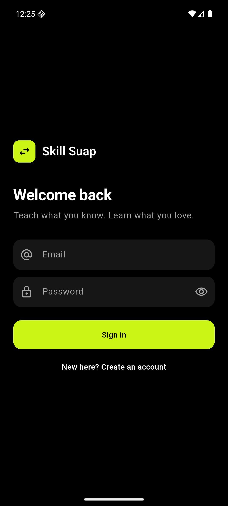 | 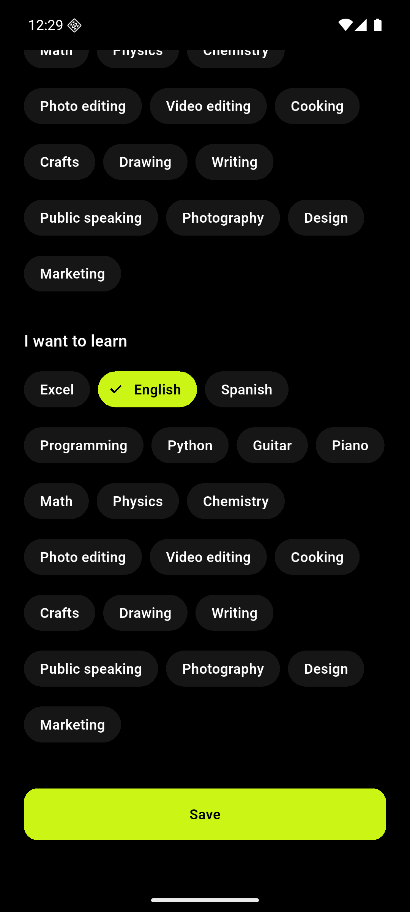 | 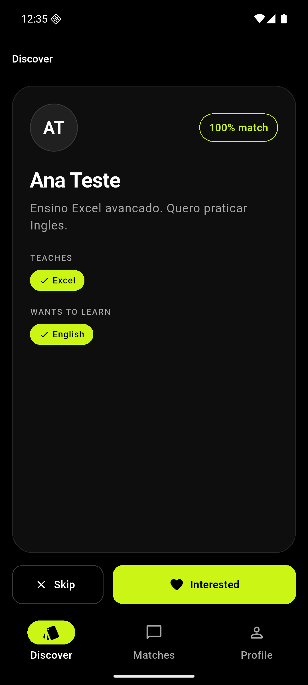 | 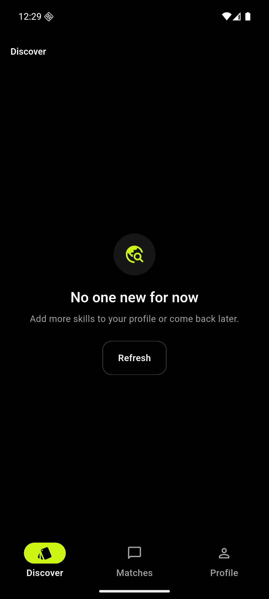 |

| Match dialog (en) | Chat (en) | Matches (pt) | Profile (pt) |
|---|---|---|---|
| 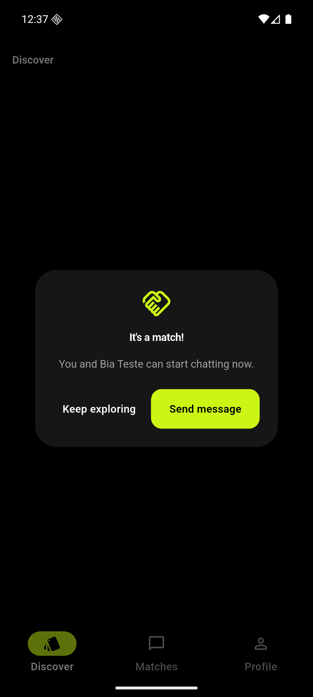 | 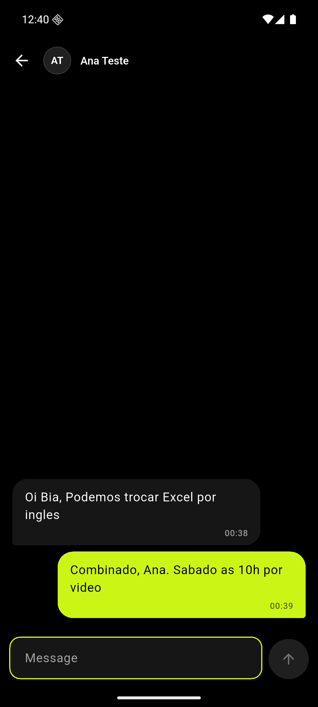 | 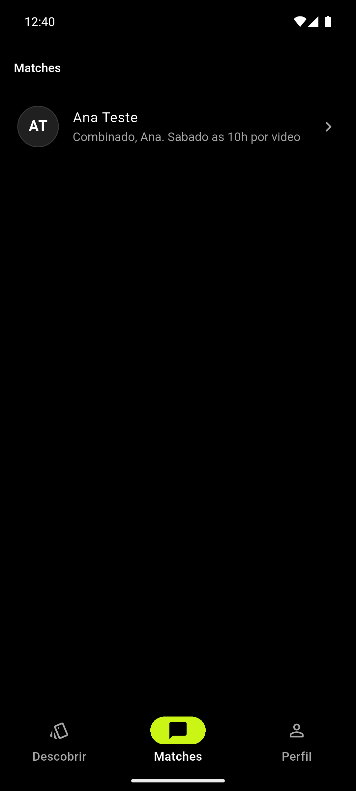 | 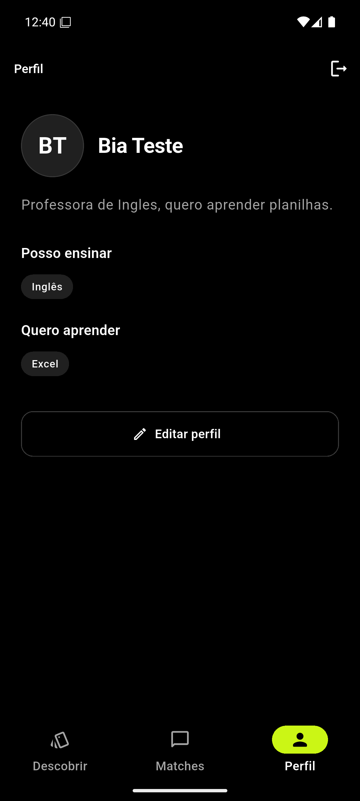 |

Common to all screens: dark brand theme, strings from ARB files, `SafeArea`, content scrolls when it does not fit (supports 200% text scale), touch targets ≥ 48 dp.

## Opening (native launch screen + SkillSwapSplashScreen)

| | |
|---|---|
| Native | Android `LaunchTheme` / `NormalTheme` (`res/values*/styles.xml`, `drawable*/launch_background.xml`, `values-v31` with a transparent Android 12+ splash icon) and iOS `LaunchScreen.storyboard`: **solid black**, no icon, so there is no white flash and no jump into the Flutter frame. |
| Class / file | `SkillSwapSplashScreen` — `lib/core/startup/skill_swap_splash_screen.dart`, mounted in `MaterialApp.router(builder:)` (`lib/app.dart`) above all routes. |
| Timeline | 0–350 ms fade-in + scale 0.82→1.0 (easeOutCubic) · 350–950 ms pulse up to 1.04 with a soft lime glow · 950–1600 ms grow to 1.12, glow fades · then, once startup is resolved, 600 ms reveal (splash fades out, app slides up 3%). If startup is slower, the logo stays with a faint breathing glow; no delay is added once ready. |
| Data | `startupResolvedProvider` (session checked; for signed-in users, profile and consent loaded; errors count as resolved). Navigation stays with the router redirect, so no protected screen is ever shown before validation. |
| States | intro, holding (waiting for startup), revealing, finished (removed from the tree; the app below keeps its state). Plays once per app launch. |
| Accessibility | Logo has a semantic label (app name); the app below is excluded from semantics and not touchable until the reveal ends; reduced motion → static logo and a 150 ms fade. |
| Responsive | Logo box = min(78% of the shortest side, 380 dp), decoded at that size. |

Real capture (Pixel 8 API 36 emulator, debug build, cold start): black → fade-in → glow and growth → reveal → Discover.

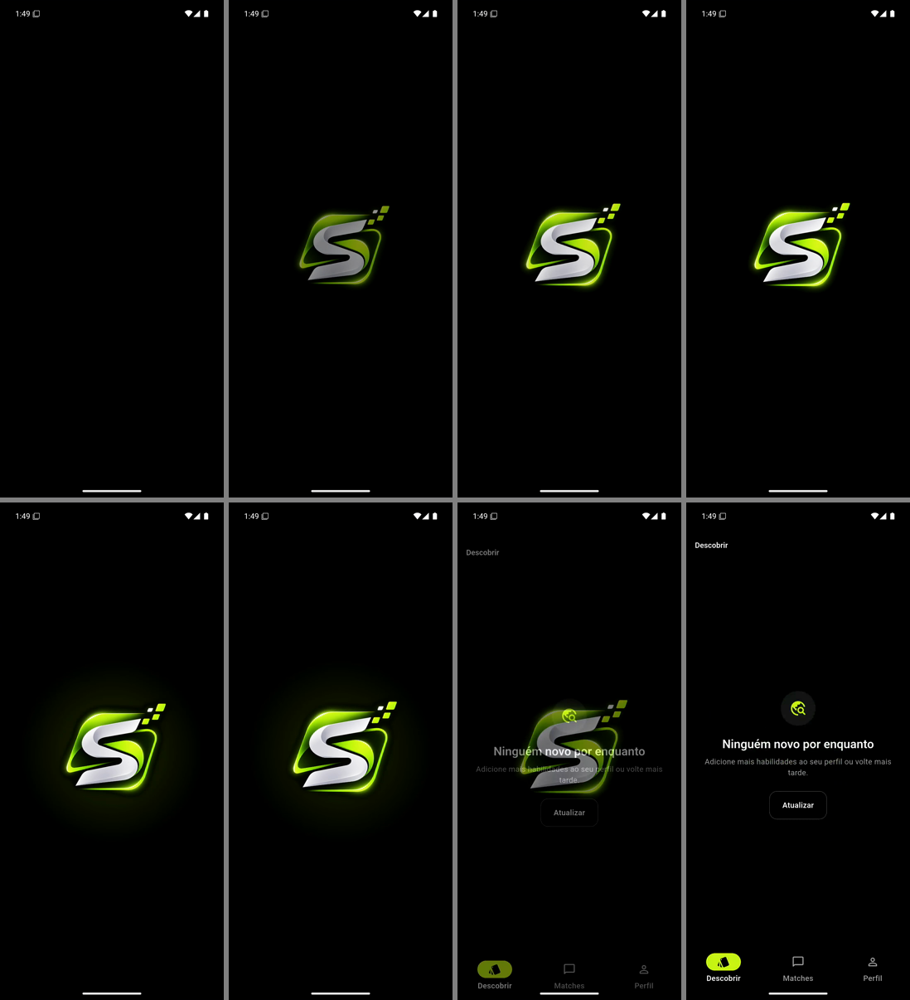

## SplashScreen (route)

| | |
|---|---|
| Class / file | `_SplashScreen` — `lib/core/router/app_router.dart` |
| Route | `/` |
| Goal | Wait for auth and profile state before routing. |
| Elements | `LoadingView`; `ErrorView` if the profile stream fails. |
| Actions | Retry (invalidates `currentProfileProvider`). |
| Data | `currentProfileProvider`. |
| Navigation | Left automatically by `resolveRedirect`. |

## SignInScreen

| | |
|---|---|
| Class / file | `SignInScreen` — `lib/features/auth/sign_in_screen.dart` |
| Route | `/sign-in` |
| Goal | Sign in or create an account. |
| Elements | Brand mark (lime square + name), title, tagline, email field, password field with show/hide, `PrimaryButton`, mode toggle `TextButton`. |
| Components | `PrimaryButton`, `TextFormField` (themed), `showAppSnackBar`. |
| Actions | Submit (button or keyboard "done"), toggle mode, toggle password visibility. |
| Data | `authRepositoryProvider`. |
| States | idle, validation errors, loading, error SnackBar. |
| Navigation | On success the router redirects. |
| Validation | See FEATURES §1. |
| Responsive | Content centered, max width 420, scrollable. |
| Accessibility | Autofill hints; visibility toggle has tooltip (label); fields have labels. |

## ProfileFormScreen

| | |
|---|---|
| Class / file | `ProfileFormScreen` — `lib/features/profile/profile_form_screen.dart` |
| Routes | `/setup` (`isEditing: false`), `/profile/edit` (`isEditing: true`) |
| Goal | Create or edit the profile. |
| Elements | Title + subtitle (setup) or AppBar (edit); name, bio fields with counters; two `FilterChip` grids; save button. |
| Actions | Toggle skills, save. |
| Data | Initial values from `currentProfileProvider`; saves via `profileRepositoryProvider`. |
| States | idle, validation errors, saving, error SnackBar, saved (edit mode: SnackBar + pop). |
| Navigation | Setup: router redirects to Discover once the profile exists. Edit: pops. |
| Responsive | Chips wrap. |
| Accessibility | Section titles marked as headers; selected chips show a checkmark, not only color. |

## DiscoverScreen (Match)

Rebuilt again 2026-11-20 from the approved neon mockup: header with the cropped logo emblem + "Skill**Swap**" wordmark, bell ("em breve" snackbar, no unread dot because there are no notifications) and graphite profile disc; tilted deck (`kDeckTilt`) with two decorative back cards and the next profile waiting under the top one; full-bleed photo card (`match_card.dart`) with neon corner light, gradient border and glow, "Quer aprender" tag, name + one-line bio, ⓘ (full profile sheet with bio, all skills and **Denunciar perfil**), Goal ("Aprender X") and Affinity (`Compatibility.score`) panels and the "Match de Conhecimento" banner; round actions sized like the mockup (`match_actions.dart`: undo 54, skip 76, approve 80 with neon glow, save 54 — save shows "em breve"). Mockup fields the app does not collect (age, city, verified badge, level) are not shown. Earlier (first) redesign: custom header (logo, wordmark, disabled bell, profile button), glass card (`GlassPanel`/`GlassChip` in `lib/core/widgets/glass.dart`), knowledge-match banner (`knowledge_match.dart`), 4 round actions (undo / skip / interested / save-disabled). Swipe card claims horizontal drags only (vertical scroll inside the card still works), exposes "Tenho interesse" / "Pular" as semantic custom actions, highlights its border lime while approving, and slides back in from the left on undo. The action row scales down on narrow screens; the header brand scales down with large text. Tested at 320 dp and 200% text (no overflow) and with tap-target and labeled-tap-target guidelines.

Real captures (emulator, demo people, 2026-11-20):

| Exchange card | Learn card | Empty state with undo | Matches |
|---|---|---|---|
| 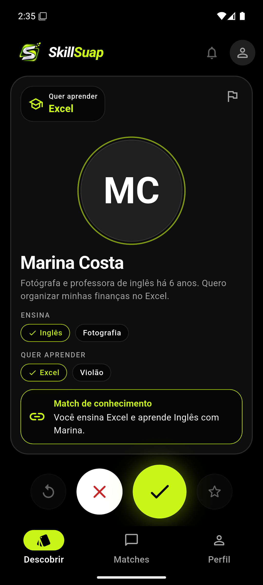 | 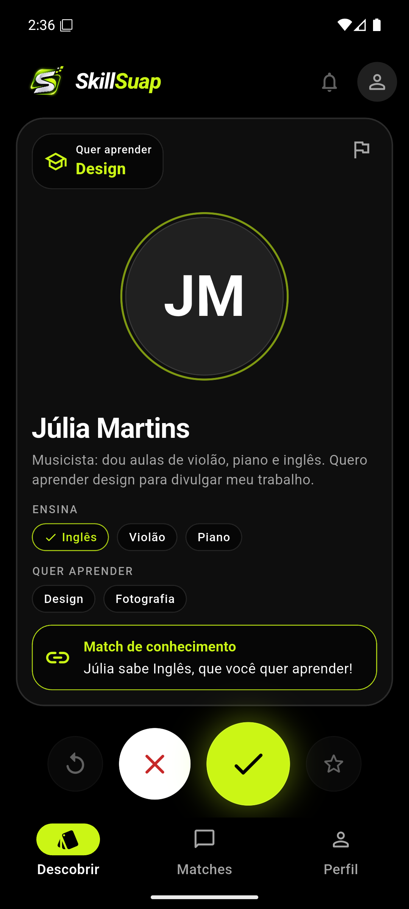 | 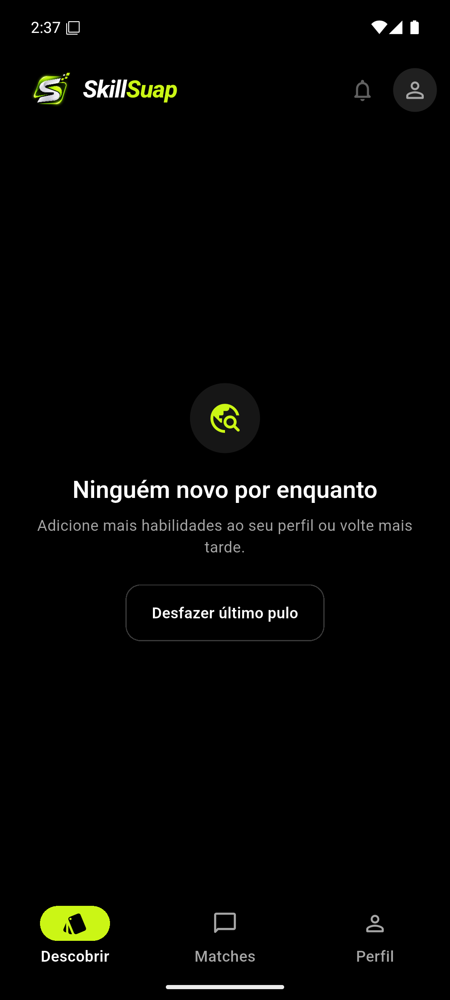 | 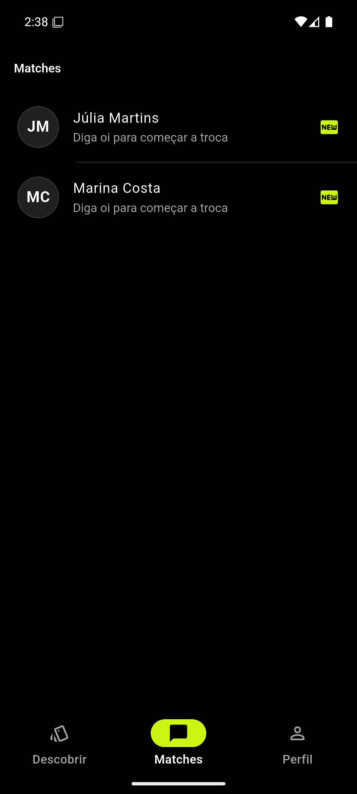 |

### Previous description

| | |
|---|---|
| Class / file | `DiscoverScreen` — `lib/features/discover/discover_screen.dart` (+ `swipe_card.dart`) |
| Route | `/discover` (shell tab 1) |
| Goal | Decide on candidates. |
| Elements | AppBar; stacked cards (top draggable, next scaled 95% behind); card: `ProfileAvatar`, compatibility badge, name, bio, two `SkillTag` groups; Skip (`OutlinedButton`) and Interested (`PrimaryButton`). |
| Actions | Drag, skip, like; match dialog → open chat or keep exploring. |
| Data | `discoverControllerProvider`, `currentProfileProvider`. |
| States | loading, empty (+ refresh), error (+ retry), deck, match dialog. |
| Navigation | Match dialog "Enviar mensagem" → `/chat/:matchId`. |
| Responsive | Card fills available height; card content scrolls on small screens or large text. |
| Accessibility | Swipe has button equivalents; drag stamps excluded from semantics; background card excluded from semantics; highlighted tags include a check icon; reduced motion respected. |

## MatchesScreen

| | |
|---|---|
| Class / file | `MatchesScreen` — `lib/features/matches/matches_screen.dart` |
| Route | `/matches` (shell tab 2) |
| Elements | `ListView.separated` of `ListTile`s: avatar, name, last message / prompt, trailing icon. |
| Actions | Tap → chat. |
| Data | `matchesProvider`. |
| States | loading, empty, error (+ retry), list. |

## ChatScreen

| | |
|---|---|
| Class / file | `ChatScreen` — `lib/features/matches/chat_screen.dart` |
| Route | `/chat/:matchId` |
| Elements | AppBar with avatar + name; reversed message list with bubbles and time; composer (multiline field up to 5 lines, round send button). |
| Actions | Send (button or keyboard send action). |
| Data | `messagesProvider(matchId)`, `matchesProvider` (for the name), `matchRepositoryProvider`. |
| States | loading, empty hint, error (+ retry), messages; sending disables button. |
| Responsive | Bubbles max 78% of width; composer stays above the keyboard (Scaffold resize). |
| Accessibility | Send button has tooltip; text contrast: black on lime, white on dark gray. |

## ProfileScreen

| | |
|---|---|
| Class / file | `ProfileScreen` — `lib/features/profile/profile_screen.dart` |
| Route | `/profile` (shell tab 3) |
| Elements | Avatar, name, bio, "Posso ensinar" and "Quero aprender" tags, Edit button, sign-out icon in AppBar. |
| Actions | Edit → `/profile/edit`; sign out (router then goes to `/sign-in`). |
| Data | `currentProfileProvider`. |
| States | loading, error (+ retry), content. |
| Accessibility | Sign-out icon has tooltip; section headers marked. |

## ConsentScreen

| | |
|---|---|
| Class / file | `ConsentScreen` — `lib/features/safety/terms_screens.dart` |
| Route | `/consent` (forced by the router for accounts without consent) |
| Elements | Shield icon, title, explanation, `ConsentCheckbox` (checkbox + "Ler os termos" link), Continue (`PrimaryButton`), Sign out. |
| States | idle, error (checkbox not ticked), saving, failure SnackBar. Router leaves once consent is stored. |

## TermsScreen

| | |
|---|---|
| Class / file | `TermsScreen` — `lib/features/safety/terms_screens.dart` |
| Route | `/terms` (reachable in any auth state) |
| Elements | AppBar + scrollable community rules text (`termsBody` in ARB). |

## Report sheet

| | |
|---|---|
| Function / file | `showReportSheet` — `lib/features/safety/safety_ui.dart` |
| Opened from | Chat menu "Denunciar"; "Denunciar perfil" in the Discover card's ⓘ profile sheet |
| Elements | Title with the person's name, confidentiality note, 5 reason radios (`RadioGroup`), details field (≤ 500), "Denunciar e bloquear". |
| States | idle, "Escolha um motivo" error, sending, failure SnackBar; closes with `true` on success. |
| Accessibility | Radios are labelled list tiles; field has a label and counter; keyboard pushes the sheet up. |

Chat additions: `⋮` menu (tooltip "Mais opções") with Desfazer match / Bloquear / Denunciar (the first two confirm in a dialog with a red confirm button); a closed match replaces the composer with "Esta conversa foi encerrada.". Profile setup additions: `ConsentCheckbox` before Save.

## Home shell

`_HomeShell` in `app_router.dart`: `NeonNavBar` (`lib/core/widgets/neon_nav_bar.dart`) with Match / Minhas Skills / Conversas / Perfil. Minhas Skills opens the profile form (where skills are edited); the Conversas badge counts active matches with no message yet (real data; there is no unread tracking). Each tab keeps its own navigation stack (`StatefulShellRoute.indexedStack`). Tapping the active tab returns to its root.
